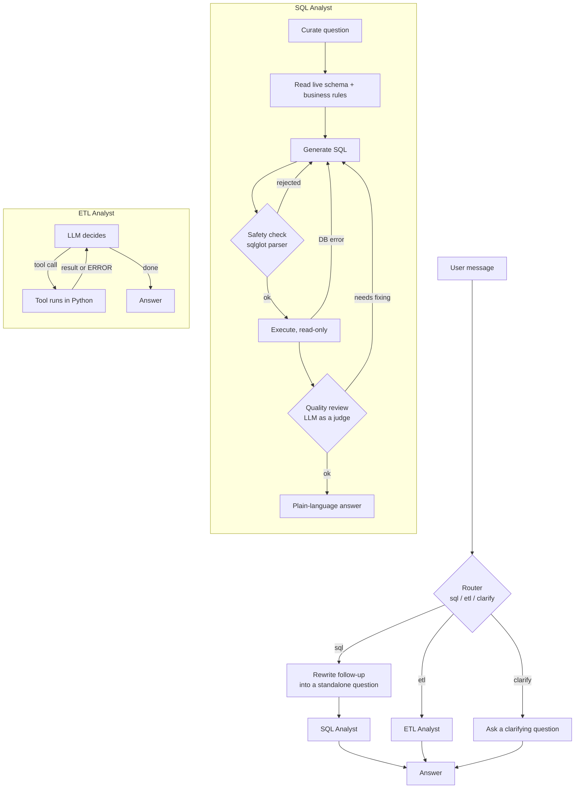

# Mercoda Mind: AI Data Agent

A multi-agent assistant that lets non-technical users work with data in plain English.
It answers business questions from a PostgreSQL database, extracts and transforms data
from APIs and files, and turns successful transforms into reusable pipelines.

Built with **LangGraph**, **LangChain**, **Pydantic**, **PostgreSQL** and **pandas**.

---

## What it can do

```text
You: Top 3 states by sales
Agent: São Paulo leads with R$555.50 in sales, then Rio de Janeiro (R$309.90) and Minas Gerais (R$210.00).

You: now only delivered orders from 2018
Agent: For delivered orders in 2018: São Paulo R$355.50, Rio de Janeiro R$249.90, Minas Gerais R$210.00.

You: Get pokemon from https://pokeapi.co/api/v2/pokemon?limit=200 as csv
Agent: Downloaded 200 rows to data/extract/pokemon.csv.

You: Keep only the ones whose name starts with "b"
Agent: 200 rows in, 9 rows out. Saved to data/transform/b_pokemon.csv (draft run #1).

You: save this as b_pokemon
Agent: Saved run #1 as pipeline 'b_pokemon'. Re-run it any time without AI.
```

*(Example session; the sales figures come from a small test dataset, not the full Olist data.)*

---

## Architecture



### 1. Data Agent (router), `agents/data_agent.py`
- Reads the **last few messages**, so follow-ups like *"save this"* or *"now by city"* go to the
  same specialist as the request before them.
- Three routes: **sql**, **etl**, or **clarify** (asks one short question when a request is unclear).
- Rewrites SQL follow-ups into standalone questions before calling the SQL Analyst.
- Keeps memory per conversation with a LangGraph checkpointer (`thread_id`).
- Keeps a separate full history for the ETL Analyst, including tool calls, so it knows what "this file" means.
- Catches sub-agent failures and returns a readable message instead of crashing.

### 2. SQL Analyst, `agents/sql_agent.py`
A fixed LangGraph pipeline with a **self-correcting retry loop** (up to 2 rewrites):

| Step | What it does |
|---|---|
| Curate | A low-cost model rewrites the question clearly |
| Context | Reads table names, columns and sample rows live from PostgreSQL, plus **business rules** (e.g. "sales = SUM(order_items.price)", "never join items and payments without aggregating") |
| Generate | A mid-tier model writes one PostgreSQL `SELECT` |
| Safety check | **Deterministic** `sqlglot` parser: one statement, read-only, no hidden writes. No LLM involved |
| Execute | Runs on a read-only session. Real Postgres errors go back to the model for a fix |
| Quality review | LLM-as-a-judge checks joins, filters and double counting against the question |
| Answer | A low-cost model explains the result in plain language, using only the returned rows |

### 3. ETL Analyst, `agents/etl_agent.py`
A **ReAct** (reason + act) tool-calling agent with 8 tools:

| Tool | Purpose |
|---|---|
| `list_files_tool` | Lists data files and where each one was downloaded from |
| `profile_file_tool` | Columns, types, nulls and sample rows (always called before a transform) |
| `extract_api_tool` | Any JSON API: auto-detects the records list, follows pagination, **reuses downloads under 24 h old** |
| `run_transform_tool` | Runs the AI's `transform(df)` safely and verifies the saved result |
| `list_runs_tool` | Lists draft runs (#1, #2, …) |
| `save_pipeline_tool` | Saves a draft as a pipeline when the user asks ("save this", "save #2", "save the grass one") |
| `list_pipelines_tool` | Lists saved pipelines |
| `run_pipeline_tool` | Re-runs a saved pipeline, with **no LLM calls** |

---

## Safety and reliability

| Risk | Protection |
|---|---|
| SQL that modifies data | `sqlglot` parser allows a single `SELECT` only, **plus** a read-only database session |
| Wrong but "valid" SQL | LLM-as-a-judge review, with business rules that prevent double counting |
| Dangerous Python from the model | AST check blocks imports other than pandas/numpy/math/re/datetime, `open`/`eval`/`exec`, dunder tricks and file I/O |
| Endless loops in generated code | Transforms run in a **separate process with a 60 s timeout** |
| The AI claiming success when it failed | Outputs are read back from disk and verified; errors come back as `ERROR: …` messages |
| Touching files outside the project | Every path is resolved and must stay inside the project folder |
| Overwriting source data | Transforms may not write to their input file; pipelines get `_v2`, `_v3` instead of overwriting |
| Runaway agent loops | Step limit per request; retry limits in the SQL Analyst |
| Repeated API downloads | Download catalog (`data/extract/.catalog.json`) with a 24 h reuse window and `refresh=true` override |

---

## Saved pipelines

Every successful transform is kept as a **draft**. Nothing becomes a pipeline until the user says so.
A saved pipeline is a normal Python script that runs **without the AI, an API key or any cost**:

```bash
python pipelines/b_pokemon.py --input data/extract/pokemon_new.csv --output data/transform/b_pokemon_new.csv
```

Each script records the original request, the date, the source run and the row counts in its header.
All pipelines are listed in `pipelines/registry.json`.

---

## Tech stack

| Area | Tools |
|---|---|
| Agent orchestration | LangGraph (StateGraph, conditional edges, checkpointer) |
| LLM interface | LangChain (tool calling, structured output) |
| Data validation | Pydantic |
| Database | PostgreSQL, psycopg2 |
| SQL safety | sqlglot |
| Data processing | pandas, numpy, requests |
| Models | Configurable in `utils/llm_pickup.py` (low / medium tiers) |

---

## Project structure

```text
.
├── agents/
│   ├── data_agent.py       # router + memory + chat loop (entry point)
│   ├── sql_agent.py        # SQL Analyst graph
│   └── etl_agent.py        # ETL Analyst (ReAct) graph and tools
├── models/
│   └── schema.py           # Pydantic state and output schemas
├── utils/
│   ├── llm_pickup.py       # chooses the model for each tier
│   ├── database.py         # PostgreSQL helper
│   ├── sql_guard.py        # sqlglot safety check
│   ├── etl_tools.py        # extract, profile, safe transform runner
│   └── pipelines.py        # draft runs, save points, re-runnable pipelines
├── data/
│   ├── extract/            # API downloads (not committed)
│   └── transform/          # transform outputs (not committed)
├── pipelines/              # saved pipeline scripts
├── .env.example
└── README.md
```

---

## Setup

### 1. Clone and install
```bash
git clone https://github.com/<your-username>/<your-repo>.git
cd <your-repo>
python -m venv .venv
# Windows: .venv\Scripts\activate    macOS/Linux: source .venv/bin/activate
pip install -r requirements.txt
```
Requires Python 3.10 or newer.

### 2. Configure environment variables
Copy `.env.example` to `.env` and fill it in:
```env
OPENAI_API_KEY=your_key_here

host=localhost
port=5432
database=olist
user=readonly_user
password=your_password
```
Use a **read-only** database user for the agent.

### 3. Load the data
This project uses the [Brazilian E-Commerce Public Dataset by Olist](https://www.kaggle.com/datasets/olistbr/brazilian-ecommerce) from Kaggle.
Download it, then load the CSV files into PostgreSQL (tables: `orders`, `order_items`,
`order_payments`, `order_reviews`, `customers`, `sellers`, `products`,
`product_category_name_translation`, `geolocation`).

### 4. Run
```bash
python agents/data_agent.py
```
Type a question. Type `sql` to see the last generated query, `exit` to quit.

---

## Design decisions

| Decision | Why |
|---|---|
| Deterministic `sqlglot` safety check before any LLM review | A parser gives the same answer every time and can't be talked into approving a write; the read-only session is a second layer |
| Real errors fed back into a retry loop | The model fixes its own mistakes (wrong column, unsafe query, reviewer objection) instead of failing on the first try |
| Business rules in the SQL prompt and in the reviewer | Prevents plausible-looking but wrong answers, such as double counting when joining items and payments |
| Low-cost models for rewriting and summarising, a stronger model for SQL | Keeps cost down without lowering accuracy where it matters |
| A `clarify` route | Asking one question is cheaper than guessing wrong |
| Follow-ups rewritten into standalone questions | The SQL Analyst stays simple (one question in, one answer out) while the conversation still feels natural |
| The model writes only `transform(df)`; reading and saving are fixed code | Generated code stays small, reusable and easy to check |
| Every tool returns facts (rows, columns, paths) or `ERROR: …` | The model reports real numbers and never claims success after a failure |
| Drafts first, pipelines only on request | Users decide what is worth keeping; saved pipelines run with no LLM at all |

---

## Limitations and next steps

- One specialist per message: "download this, then query it with SQL" is not yet split into steps.
  Next: a planner that chains ETL → load into Postgres → SQL.
- Conversation history grows over long chats; trimming or summarising older messages is planned.
- The transform sandbox blocks common misuse but is not full isolation. For untrusted users, run transforms in a container.
- The schema is read on every SQL question; caching would make answers faster.

---

## Acknowledgements

- Olist, for publishing the e-commerce dataset.

## License

MIT (code). The Olist dataset has its own license; see its Kaggle page.
